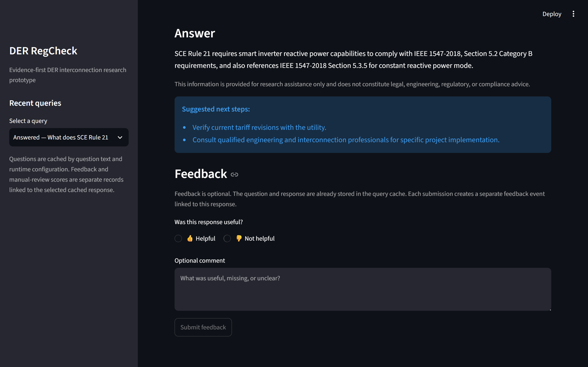
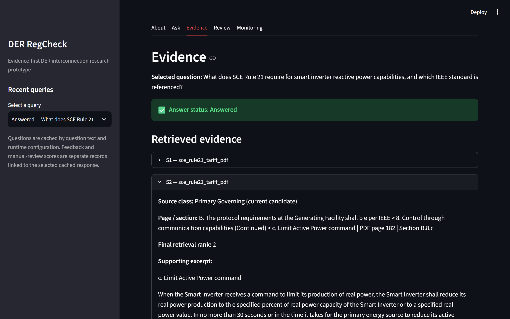
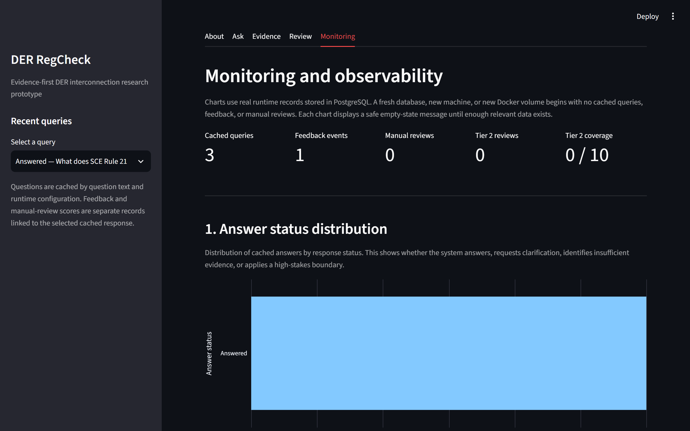

# DER RegCheck

An evidence-first retrieval-augmented generation (RAG) assistant for researching distributed energy resource (DER) interconnection requirements. It answers questions over a small, curated corpus of public California Rule 21 / Southern California Edison (SCE) documents, shows the evidence behind every answer, and rejects answers whose citations do not check out.

It is a research-support prototype. It does not provide legal, regulatory, engineering, or compliance advice.

The project was started on 21 August 2026 as a course project and is now maintained as a portfolio project and a base for further experimentation. Git history shows a single author. The course context is only background: the repository is no longer organised around any assessment criteria.



---

## Contents

- [The problem](#the-problem)
- [What it does](#what-it-does)
- [Architecture](#architecture)
- [Technology](#technology)
- [Evaluation results](#evaluation-results)
- [Getting started](#getting-started)
- [Configuration](#configuration)
- [Testing](#testing)
- [Repository layout](#repository-layout)
- [Design decisions](#design-decisions)
- [What this project demonstrates](#what-this-project-demonstrates)
- [Limitations and known issues](#limitations-and-known-issues)
- [Documentation](#documentation)
- [Data, copyright and responsible use](#data-copyright-and-responsible-use)

---

## The problem

Anyone assessing a DER project or market in California has to read across a fragmented set of public documents: a regulator overview, a utility tariff of several hundred pages, a technical interconnection handbook, a testing and certification instruction sheet, web guidance, and historical working-group reports. The relevant provisions are scattered, conditional, and version-sensitive, and the sources differ in authority (a tariff governs, a web page only explains, a draft recommendation is historical).

A general-purpose LLM answers such questions fluently but without sources, and it does not know which document outranks another. DER RegCheck instead retrieves passages from the actual documents, tells the model which source tier each passage comes from, and requires every claim in the answer to cite a retrieved passage.

## What it does

- **Builds a citation-preserving knowledge base** from six public sources (about 1,049 chunks). Each chunk keeps its PDF page, tariff sheet, section IDs and heading path.
- **Retrieves evidence** with pgvector similarity search over 50 candidates, then reranks them with a local cross-encoder and keeps the top 10.
- **Generates structured answers** with Gemini. The model returns a schema with an answer status (`answered`, `partial`, `needs_clarification`, `insufficient_evidence`, `high_stakes_boundary`), claims with citation labels, an uncertainty statement, evidence gaps, and suggested next research steps.
- **Validates citations deterministically.** Any citation label that is not in the supplied evidence pack causes the answer to be rejected (fail closed). The check covers label validity only, not whether the cited text really supports the claim.
- **Exposes the evidence.** The Streamlit app has five tabs: About, Ask, Evidence (source class, heading path, page locators, retrieval rank), Review (1 to 5 manual scoring on five dimensions), and Monitoring (seven charts over stored telemetry).
- **Caches and records** answers, feedback and manual scores in PostgreSQL (`query_cache`, `answer_feedback`, `manual_scores`). The cache key includes the prompt version and retrieval configuration.

| Evidence tab | Monitoring tab |
|---|---|
|  |  |

Further screenshots: [`docs/images/`](docs/images/) (Ask and Review tabs).

## Architecture

Offline pipeline (scripts under `src/ingestion`, `src/processing`, `src/scripts`). Its outputs are committed, so you do not need to run it to use the app.

```text
download (requests)            data/corpus/              (not committed)
   -> extract raw content      data/processed/extracted/     pypdf pages, BeautifulSoup headings
   -> normalise evidence       data/processed/normalised/    source-specific rules, tariff parser
   -> structural chunking      data/processed/chunks/        citation metadata, neighbour links
   -> embed (Nomic v1.5, 768d) data/processed/embeddings/
   -> load                     PostgreSQL + pgvector (chunks, chunk_embeddings)
```

Runtime path (the app and `src/scripts/demo_rag.py`):

```text
user question
  -> Nomic query embedding (local, "search_query:" prefix)
  -> pgvector top 50 candidates
  -> BAAI/bge-reranker-base cross-encoder (local) -> top 10 chunks
  -> evidence pack with labels S1..S10 and source-authority metadata
  -> Gemini structured output (prompt v3_few_shot_grounded_rag)
  -> deterministic citation validation (fail closed)
  -> query_cache row -> Streamlit tabs (answer, evidence, review, monitoring)
```

Query expansion (an LLM rewrite of the question before retrieval) is implemented in `src/retrieval/query_expansion.py` but disabled at runtime. See [Evaluation results](#evaluation-results).

## Technology

| Area | Tools |
|---|---|
| Language and packaging | Python 3.13, `uv` (lockfile committed) |
| Extraction | `pypdf`, `beautifulsoup4`, `requests` |
| Embeddings and reranking | `nomic-ai/nomic-embed-text-v1.5` (revision pinned in `config/embedding.yaml`), `BAAI/bge-reranker-base`, `sentence-transformers`, PyTorch via `transformers` |
| Storage and search | PostgreSQL 16 with `pgvector` (IVFFlat cosine index) and a full-text search column kept current by a trigger |
| LLM | Google Gemini via `google-genai` (default `MODEL_ID` is `gemini-3.5-flash-lite`), Pydantic structured output, client-side rate limiting and retries |
| UI | Streamlit |
| Runtime | Docker, Docker Compose, Makefile wrappers |
| Tests | `unittest` (also runs under `pytest`) |

## Evaluation results

All numbers below come from committed artefacts in [`data/evaluation/`](data/evaluation/). Methodology and caveats are in [`docs/evaluation-notes.md`](docs/evaluation-notes.md). Treat them as indicative: the benchmarks are small, LLM-generated or curated by the author, and scored against metadata or by an LLM judge, not by independent human experts.

**Retrieval (100 synthetic queries, each tied to one gold chunk, 7,500 configuration records, PostgreSQL path)**

| Configuration (equal weighting) | nDCG@10 | MRR |
|---|---:|---:|
| Lexical (PostgreSQL full-text) | 0.154 | 0.155 |
| Vector | 0.763 | 0.873 |
| Hybrid (alpha 0.5) | 0.767 | 0.873 |
| Vector + cross-encoder rerank (deployed) | 0.946 | 0.925 |

Reranking was the largest effect. Recall@10 is about 0.10 for every configuration because each query has a single gold chunk and the label scheme counts metadata-related chunks, so it is not a useful headline number. Expanding the query before retrieval scored marginally higher (nDCG@10 0.9471) but added roughly 36 seconds of latency in live testing, so the app uses the original query.

**Prompt selection (24 fixed questions, 3 prompts, LLM judge plus deterministic validation)**

`v3_few_shot_grounded_rag` was the only prompt with 100% valid citations (v1 21/24, v2 22/24, v3 24/24). On judge composite the three prompts are close (v1 4.86, v2 4.91, v3 4.88) and v3 is not the top scorer, so it was chosen under the citation-validity guardrail rather than on score. An earlier version of the summary double-counted repeated records; it has been corrected (see [evaluation notes](docs/evaluation-notes.md#results)).

**Does retrieval help? (10 curated questions, 4 conditions, blinded pairwise LLM judge)**

Retrieval-backed answers were preferred to a no-evidence baseline in 8 of 10 comparisons. Full v3 against zero-shot RAG was mixed (5 wins for zero-shot, 3 for v3, 2 ties), so the evidence does not show that the v3 prompt beats a simpler RAG prompt. The judge and the generator are the same model family.

**Human review:** the Review workflow exists, but the repository contains only 2 manual scores and 3 feedback events (they look like development test entries), so there are no aggregate human-review results.

## Getting started

### Prerequisites

- Docker and Docker Compose
- A Google AI (Gemini) API key
- For local development: Python 3.13 and [`uv`](https://github.com/astral-sh/uv)
- Disk space and network access for the first run. PyTorch and two Hugging Face models (Nomic embedder, `bge-reranker-base`) are downloaded when the app first loads them. The Compose setup has no model-cache volume, so a recreated container downloads them again.

### Option A: Docker Compose (app and database)

```bash
cd der-regcheck
cp .env.example .env            # then set GOOGLE_API_KEY in .env

docker compose up -d --build    # or: make docker-build && make docker-up
make db-init-docker             # create schema (one time)
make load-chunks-docker         # load committed chunks and embeddings (one time)
```

Open <http://localhost:8501>. The first question is slow because the models load.

The database schema and data are not created automatically at startup, so the two `make` steps above are required on a fresh volume. (Checked on 2026-11-19: `docker compose up --build` gave two healthy containers, and `make load-chunks-docker` ran cleanly twice on an already populated database. A load into an empty volume and a full question through the UI have not been checked yet; see [known issues](docs/known-issues-and-roadmap.md#verification-status).) Verify the load with:

```bash
docker compose exec db psql -U postgres -d der-regcheck -c "SELECT count(*) FROM chunks;"   # expect 1049
```

Stop with `make docker-down`. `make docker-clean` also deletes the database volume, including cached answers, feedback and manual scores.

### Option B: local Python, database in Docker

```bash
uv sync
cp .env.example .env            # set GOOGLE_API_KEY; DATABASE_URL already points at localhost
docker compose up -d db
make db-init
make load-chunks                                  # same as: python -m src.scripts.load_chunks_to_db with the default directories
make ui                                            # Streamlit on http://localhost:8501
```

### Try it without the UI

```bash
make demo-retrieval     # retrieval and reranking only (database and local models, no Gemini call)
make demo-rag           # full answer with citations
```

Both accept `--question` and `--top-k`. Example question: *What does SCE Rule 21 require for smart inverter reactive power?*

The full set of commands (rebuilding each pipeline stage, re-running evaluations, troubleshooting) is in [`docs/runbook.md`](docs/runbook.md).

## Configuration

Settings come from environment variables (`.env`, loaded with `python-dotenv`) and four YAML files.

| Variable | Used by | Notes |
|---|---|---|
| `DATABASE_URL` | all database code | Required. `localhost` for local runs. Compose overrides it with the `db` host for the app container. |
| `GOOGLE_API_KEY` | LLM client | Required for answer generation, query rewriting, synthetic queries and judging. |
| `MODEL_ID` | LLM client | Defaults to `gemini-3.5-flash-lite`. |
| `POSTGRES_DB`, `POSTGRES_USER`, `POSTGRES_PASSWORD`, `POSTGRES_PORT` | `compose.yaml` | Defaults `der-regcheck`, `postgres`, `postgres`, `5432`. Defaults are for local use only. |
| `STREAMLIT_PORT` | `compose.yaml` | Host port mapping only. The container always listens on 8501. |

| File | Controls |
|---|---|
| `config/normalisation.yaml` | Per-source page skips, boilerplate patterns, heading patterns |
| `config/chunking.yaml` | Token limits, table policy, source authority and currency tiers |
| `config/embedding.yaml` | Embedding model, pinned revision, prefixes, output directory |
| `config/retrieval.yaml` | Reranker candidate limit and top-k, hybrid alpha, weighting schemes for evaluation |

## Testing

```bash
make test           # unittest over tests/ (see Makefile)
uv run pytest       # alternative; pytest is a dev dependency
```

The 11 test modules cover normalisation (including four real tariff page fixtures), structural chunking, chunk and normalisation quality checks, the answer generator and citation validator, evaluator and summariser logic, the demo script, and the database schema.

State as last checked (documentation review, 2026-11-18, Python 3.11 with CPU PyTorch, no database, no Hugging Face access): 36 passed, 7 skipped, 1 error. The 7 skipped tests are database integration tests that need `DATABASE_URL` and a loaded database. The error is `tests/test_embed_chunks.py`, which downloads the Nomic model. Those 8 tests were not run, and the project targets Python 3.13, which was not available for that check.

There are no tests for the Streamlit app, the query cache, or the LLM client, and no CI configuration.

## Repository layout

```text
der-regcheck/
├── src/
│   ├── ingestion/        download_california_rule21_docs.py, extract_raw_content.py
│   ├── processing/       normalise_documents.py, chunk_documents.py, embed_chunks.py, quality checks
│   ├── database/         db_init.py (schema), db_chunks.py (load), db_connection.py (pool)
│   ├── retrieval/        retrieve.py (SQL), rerank.py, runtime_retriever.py, production_pipeline.py, query_expansion.py
│   ├── generation/       answer_generator.py, prompts.py, schemas.py, citation_validator.py
│   ├── evaluation/       query generation, retrieval grid, prompt and RAG-impact evaluation, summarisers
│   ├── observability/    query_cache.py (cache, feedback, manual scores), timing.py
│   ├── ui/               streamlit_app.py (single file, about 1,600 lines)
│   ├── scripts/          demo_rag.py, demo_retrieval.py, load_chunks_to_db.py
│   └── llm_client.py     Gemini client with rate limiting and retry
├── config/               YAML configuration for each pipeline stage
├── data/
│   ├── processed/        extracted, normalised, chunks, embeddings (committed)
│   ├── evaluation/       benchmarks, results, summaries, reports (committed)
│   └── feedback/         runtime feedback log (written by the app; empty in the repo)
├── tests/                unittest modules and fixtures
├── docs/                 runbook, decisions, evaluation notes, dataset notes, project log, known issues
├── Dockerfile, .dockerignore, compose.yaml, Makefile, pyproject.toml, uv.lock, .env.example, LICENSE
```

`data/corpus/` (raw downloads) is git-ignored and absent from a fresh clone. `src/database/db_monitoring.py`, `src/ingestion/analyse_structure.py` and the `src/monitoring/` package are empty placeholders.

## Design decisions

The 21 decision records in [`docs/decisions.md`](docs/decisions.md) give alternatives and trade-offs. The ones that shape the system most:

- **Keep citation text separate from embedding text.** Chunks store unchanged `evidence_text` for citation and a heading-prefixed `embedding_text` for search (Decisions 07, 08).
- **Structural chunking, not fixed windows.** Chunks follow the document's blocks, keep tables with their context, and flag oversized blocks rather than splitting them mid-block (Decision 08).
- **Source authority is metadata.** The tariff is `primary_governing`, the handbook `primary_technical`, and the SIWG report `historical_draft`/`historical_only`. This reaches the prompt as a label on each evidence item. It is not yet used to filter retrieval (Decision 05).
- **Re-run the retrieval evaluation on the runtime path.** The first two evaluations used an in-memory evaluator. Because those results did not describe what the app does, the grid was repeated against PostgreSQL and the earlier numbers were kept as history only (Decision 12).
- **Evaluation winner is not always the runtime choice.** Expanded-query retrieval won by a small margin but cost about 36 seconds, so it is off (Decision 13).
- **Select the prompt with a hard guardrail.** 100% valid citations first, judge score second (Decision 14).
- **Fail closed.** Unknown citation labels or empty retrieval yield an insufficient-evidence response instead of a guess.
- **Cache by configuration.** A cached answer is reused only for the same question, prompt version and retrieval configuration (Decision 16).
- **Commit processed data, not raw sources.** This makes the app runnable from a clean clone and avoids redistributing source PDFs (Decision 20).

## What this project demonstrates

Everything below can be inspected in the repository. The work is a single-author project.

- **Data engineering for messy documents.** Page-preserving PDF extraction, a source-specific normaliser with a dedicated tariff hierarchy parser (regression-tested on real pages), manual-replacement provenance for a source that blocks automated download, and quality reports at each stage.
- **Retrieval engineering.** A pgvector and full-text schema, vector, lexical and reciprocal-rank-fusion hybrid search, cross-encoder reranking, and query rewriting (expansion and HyDE).
- **LLM application design.** Schema-constrained output, an evidence pack with stable labels, deterministic citation validation, abstention statuses, and prompt versions compared under a guardrail.
- **Evaluation practice.** A two-tier design, a 7,500-record retrieval grid and an 8,000-record rewrite grid with checkpoint and resume, an LLM judge with a blinded pairwise comparison, and written limitations. The earlier file-based retrieval results were re-run on the PostgreSQL runtime path and the old numbers were kept only as history.
- **Application and operations.** A Streamlit interface over the pipeline, PostgreSQL-backed cache, feedback and review tables, a monitoring dashboard, and a multi-stage Docker build with Compose.
- **Documentation.** A decision log, a dated project log, and a runbook.

## Limitations and known issues

Summary. The full list, with suggested fixes, is in [`docs/known-issues-and-roadmap.md`](docs/known-issues-and-roadmap.md).

- **Narrow corpus.** Six public documents, California Rule 21 and SCE only. Sources can change at their URLs, and content hashes only detect that after the fact.
- **Weak evaluation labels.** Retrieval relevance is derived from chunk metadata, queries are LLM-generated from the chunks, and there is one gold chunk per query. Answer quality is judged by an LLM from the same model family, on small question sets. None of this establishes regulatory correctness.
- **Citation check is structural.** It confirms labels exist, not that the cited passage entails the claim.
- **No source-aware retrieval filtering.** Authority and currency tiers are shown to the model but do not constrain retrieval.
- **Extraction artefacts.** Some PDF extraction noise remains in citation text.
- **Not production-ready.** No authentication, HTTPS, secrets management, backups, rate limiting for users, CI, or tests for the UI. Default database credentials are for local use only.
- **Documentation and tooling drift found during the last review.** Some older runbook commands did not match the scripts (corrected; see the known-issues file).
- **Licence covers the code only.** The code is MIT-licensed (see [`LICENSE`](LICENSE)). The processed source-document derivatives in `data/processed/` remain the property of their publishers.

## Documentation

| Document | Use it for |
|---|---|
| [`docs/runbook.md`](docs/runbook.md) | Setup, rebuilding each pipeline stage, re-running evaluations, troubleshooting |
| [`docs/known-issues-and-roadmap.md`](docs/known-issues-and-roadmap.md) | Current state, verified findings, and what to do next |
| [`docs/decisions.md`](docs/decisions.md) | Design decisions with alternatives and trade-offs |
| [`docs/evaluation-notes.md`](docs/evaluation-notes.md) | Evaluation design, full results, interpretation and limitations |
| [`docs/dataset-notes.md`](docs/dataset-notes.md) | Sources, provenance, schemas and processing rules |
| [`docs/project-log.md`](docs/project-log.md) | Chronological build journal (2026-08-21 to 2026-09-06) |

## Data, copyright and responsible use

The repository commits processed, machine-readable derivatives of public CPUC and SCE documents (extracted text, normalised blocks, chunks, embeddings), not the original PDF and HTML files. The originals remain the property of their publishers. Verify copyright and fair use before redistributing the processed data. The MIT licence in [`LICENSE`](LICENSE) applies to the project's own code and documentation, not to that derived source material.

DER RegCheck is a research aid. Check important conclusions against the current authoritative source, confirm the applicability conditions, treat historical material as historical, and consult qualified professionals for project decisions.
